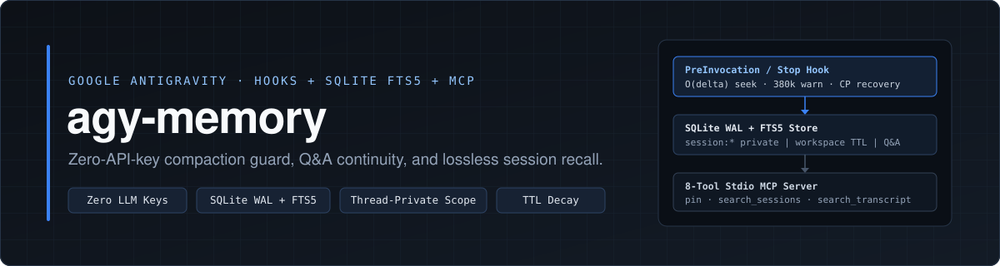
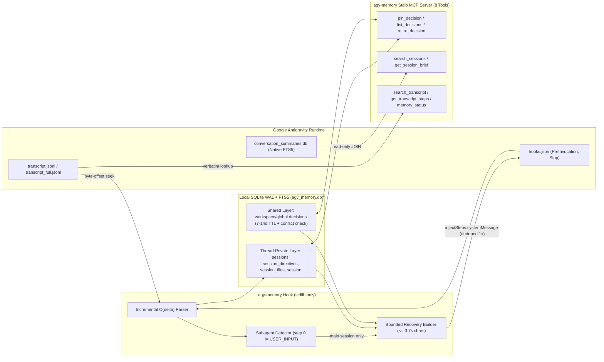

<p align="center">
  
</p>

<p align="center">
  <a href="README.zh-CN.md">简体中文</a> &middot;
  <a href="#why-agy-memory">Why</a> &middot;
  <a href="#architecture">Architecture</a> &middot;
  <a href="#benchmarks">Benchmarks</a> &middot;
  <a href="#quick-start">Quick Start</a> &middot;
  <a href="#mcp-tools">MCP Tools</a> &middot;
  <a href="#trade-offs--limitations">Trade-offs</a>
</p>

<p align="center">
  
  
  
  
  
</p>

**`agy-memory`** is a lightweight, local-first compaction guard and lossless session memory layer for **Google Antigravity** (`Antigravity 2.0` / `agy` CLI).

It runs on **100% Python standard library + local SQLite WAL/FTS5** (including its built-in stdio JSON-RPC 2.0 MCP server) — **zero third-party runtime dependencies, zero external LLM API keys, zero cloud accounts, zero background worker daemons**.

---

## Why `agy-memory`?

Auditing **19 automatic compactions** across **4 long-horizon production sessions (13 main compactions + 6 subagent compactions)** in Antigravity revealed four structural failure modes in native `CHECKPOINT` compaction:

| Observed Failure Mode (19 Native Auto-Compactions) | Measured Baseline | Root Cause in Native `CHECKPOINT` | How `agy-memory` Fixes It |
| --- | --- | --- | --- |
| **1. Hard 10-turn user-request eviction** | 100% of sessions > 10 turns dropped earlier verbatim requests | `# User Requests` hard-caps at the last 10 user turns | Incremental byte-offset SQLite ledger preserves all turns and prioritizes evicted declarative constraints |
| **2. Complete loss of assistant replies** | `0/6` to `0/5` key points survived for recent Q&A discussions right before compaction | Native `CHECKPOINT` wipes 100% of `PLANNER_RESPONSE` history and summarizes into a coding-progress template (80%+ code/steps, 0% Q&A section) | Captures final user-facing replies (`tool_calls == []`), distills conclusions/options deterministically, and restores the last 4 Q&A pairs + verbatim `step` pointers |
| **3. Sudden 500k compaction without `PreCompact` hook** | Main compactions fired at median `508,690` tokens (`10/13` full prompt-cache resets) with zero warning | Antigravity hooks (`SessionStart`, `PreInvocation`, `PostInvocation`, `PreToolUse`, `PostToolUse`, `Stop`) do not expose a `PreCompact` event | `PreInvocation` tracks token usage and triggers a silent state-checkpoint reminder at `430k` tokens (configurable) — **never nudging early `/compact`** |
| **4. Post-compaction path hallucinations & re-read storms** | Up to `12/12` (100%) immediate file re-reads within 60 steps; non-existent paths guessed on step +1 | Summarizer flattens directory trees and drops verified file paths | Tracks every `write_file`/`edit_file`/`read_file` path per session and injects compact verified path anchors |
| **5. Dead cross-session recall** | Native `conversation_summaries.db` (SQLite FTS5) is never exposed to the agent | No built-in MCP search tool over local transcripts or structured decisions | Exposes 8 stdio MCP tools querying both `agy_memory.db` and Antigravity's native `conversation_summaries.db` FTS5 index |

---

## Architecture



### Anti-Dilution & Anti-Staleness Design

Memory systems frequently hurt agent quality when they blindly dump text into the prompt. `agy-memory` enforces five explicit guardrails:

1. **Strict Scope Separation (`session:<cid>` vs. Workspace vs. Global)**
   - **Thread-private (`scope="session"`, requires `conversation_id`)**: restored *only* when that specific thread compacts. Never leaks into parallel threads working in the same repository.
   - **Workspace shared (`scope="/path/to/repo"`)**: holds only incremental architecture locks or vetoes not already written in `GEMINI.md` / `AGENTS.md`.
2. **Zero Subagent Pollution**
   - Detects subagents deterministically from `step 0` (`type != USER_INPUT`). Subagents receive `{}` (`0` bytes) on startup and **only** verified touched file paths (plus their own private pins, if any) if they compact.
3. **Automatic TTL Decay & Conflict Detection**
   - Decisions expire from automatic injection after **14 days** (`veto` / `architecture` / `preference`) or **7 days** (`decision` / `lesson`), remaining searchable on demand via `search_sessions`.
   - Every injected item carries an explicit age tag (`[2026-11-25·today]`) and a top priority guardrail (*later user instructions always override earlier memory*).
   - `pin_decision` scans active same-scope entries and returns `potential_conflicts` so superseded rules can be retired immediately via `retire_decision`.
4. **Question Filtering on Auto-Extraction**
   - Interrogative user turns (`?`, `Why...`, `能不能...`, `...吗`) are excluded from declarative constraint extraction.
5. **Hard Byte Budgets & One-Time Deduplication**
   - Normal non-compaction turns return `{}` (0 bytes injected, prompt cache untouched).
   - Post-compaction recovery fires **at most once per `CHECKPOINT` step** and replaces verbose full-file handoff dumps with a compact `<= 3.7k` character packet.

---

## Benchmarks

All numbers below are freshly measured with the included anonymized, self-contained benchmark fixture (`625` steps, `24` user turns reaching `508k` tokens, `1` main compaction + parallel thread + subagent). Run it yourself:

```bash
python benchmarks/run_benchmark.py
```

| Metric | Measured Result | Notes |
| --- | ---: | --- |
| **Steady-state `PreInvocation` hook (in-process)** | **1.67 ms** | Median over 10 runs (`O(delta)` byte-offset seek, returns `{}`) |
| **Steady-state `PreInvocation` hook (full subprocess, Windows Python 3.14)** | **107.68 ms** | Includes OS process + Python startup; returns `{}` |
| **Main session cold-start injection** | **537 chars** (`13.19 ms`) | Incremental workspace decisions only; no `handoff.md` duplication |
| **Subagent cold-start injection** | **0 chars** (`7.24 ms`) | Deterministic `step 0` detection; zero context dilution |
| **430k silent pre-compaction checkpoint** | **504 chars** (`19.89 ms`) | Silently saves unsaved specs before ~500k; never prompts user to `/compact` early |
| **Post-compaction recovery packet** | **3,700 chars** (`37.82 ms`) | Bounded size; fired once per `CHECKPOINT` |
| **Recent Q&A assistant reply recall** | **3 / 3 (100%)** | Recovers options & conclusions wiped by native `CHECKPOINT` |
| **Evicted early veto recall (> 10 turns ago)** | **2 / 2 (100%)** | Prioritizes declarative constraints over routine turns |
| **Thread-private pin recovered on own compaction** | **Yes (`true`)** | `scope="session"` restored on Thread A |
| **Cross-thread leakage to parallel Thread B** | **0 (`false`)** | Thread B in same workspace sees 0 bytes of Thread A's private pin |

> **Live production observation (anonymized):** In real daily Antigravity 2.0 usage on Windows, `Stop` sync events complete in `4.2–41 ms`, subagent startup skips complete in `~5.0 ms`, and pre-compaction checkpoint hooks trigger cleanly in `~41.8 ms`.

---

## Quick Start

### 1. Install

Requires **Python 3.11+** (SQLite FTS5 is bundled with standard Python).

```bash
git clone https://github.com/JieX133/agy-memory.git
cd agy-memory
pip install -e .
```

### 2. Wire Hooks and MCP Server

```bash
# Registers PreInvocation/Stop hooks in ~/.gemini/config/hooks.json (with automatic backup)
# and registers agy-memory in ~/.agent-runtime/mcp/mcp.json (if present) or ~/.gemini/config/mcp_config.json
agy-memory install
```

Options:
- `--hooks-only` — register lifecycle hooks only (if you manage MCP configs manually)
- `--mcp-config /path/to/mcp.json` — target a specific MCP config file
- `--lang zh` — emit Chinese headers in injected recovery packets (default: `en`)
- `agy-memory doctor` — verify Python, SQLite FTS5, `mcp` SDK, hook wiring, and recent hook timings
- `agy-memory uninstall` — cleanly remove entries (keeping backups)

### 3. Optional Global Rule Snippet (`~/.gemini/GEMINI.md`)

Add these 4 lines so your agent uses the MCP tools proactively:

```markdown
## Session Memory & Compaction Discipline
- Pin thread-local specs with `pin_decision(scope="session", conversation_id="<cid>")`; pin durable cross-thread workspace decisions (not already in `GEMINI.md`/`AGENTS.md`) with workspace `scope`. Retire superseded IDs via `retire_decision`.
- On `[Memory Guard | Pre-Compaction Checkpoint]`, do NOT ask the user to compact early; silently pin any unsaved specs/decisions before native ~500k compaction occurs.
- On `[Memory Guard | Post-Compaction Recovery]`, obey verified file paths and call `search_transcript` / `get_transcript_steps` whenever exact pre-compaction text is needed.
- To recall prior conversations without pasting UUIDs, call `search_sessions` / `get_session_brief`.
```

### Environment Variables

| Variable | Default | Description |
| --- | --- | --- |
| `AGY_MEMORY_HOME` | `~/.gemini/config/memory` | Directory storing `agy_memory.db` |
| `AGY_MEMORY_DB` | `<AGY_MEMORY_HOME>/agy_memory.db` | Explicit SQLite DB path override |
| `AGY_BRAIN_DIR` | `~/.gemini/antigravity/brain` | Antigravity transcripts root |
| `AGY_SUMMARIES_DB` | `~/.gemini/antigravity/conversation_summaries.db` | Native Antigravity FTS5 summaries DB |
| `AGY_WARN_CTX_TOKENS` | `430000` | Token threshold for silent pre-compaction checkpoint reminder (never nudges early `/compact`) |
| `AGY_MEMORY_LANG` | `en` | Injected packet header language (`en` or `zh`) |

---

## MCP Tools

| Tool | Purpose |
| --- | --- |
| `pin_decision(title, content, category, scope, conversation_id, ttl_days)` | Save/update a `session`-private, workspace, or global decision with TTL & automatic conflict check |
| `list_decisions(scope, conversation_id, category, include_expired)` | Inspect active decisions (workspace queries never expose `session:*` private rows) |
| `retire_decision(decision_id, reason)` | Deactivate an outdated or superseded decision |
| `search_sessions(query, workspace, limit)` | Full-text search across Antigravity's native `conversation_summaries.db` FTS5 (joined with decoded `workspace_uris` & `title`) + `agy_memory.db` |
| `get_session_brief(conversation_id, tail_turns)` | Structured brief of any session: **all** user requests (uncapped), compaction steps, modified files, and tail turns |
| `search_transcript(conversation_id, query, max_hits)` | Lossless verbatim grep over `transcript_full.jsonl` |
| `get_transcript_steps(conversation_id, start_step, end_step, max_chars)` | Bounded verbatim step expansion (pair with `step N` pointers from post-compaction Q&A recovery) |
| `memory_status()` | Store counters, expired decision count, and last 15 hook execution latencies |

---

## Trade-offs & Limitations

- **Cannot prevent native prompt-cache resets on compaction**: `agy-memory` operates through Antigravity's public hook API; when Antigravity runs native compaction at ~500k tokens, prompt cache invalidation is internal to the host runtime. Pairing `agy-memory` with a tool-output sandbox (such as `context-mode` MCP) helps delay hitting 500k in the first place.
- **Python subprocess overhead**: `PreInvocation` runs synchronously in Antigravity. While SQLite incremental parsing takes `~1.7 ms`, spawning Python adds `~90–110 ms` per turn on Windows (negligible relative to multi-second model turns, but worth noting).
- **Deterministic reply distillation**: Assistant replies longer than 320 characters are distilled heuristically (lead line + headings + bold/numbered options) without calling an external LLM. Large tables or full code snippets require one on-demand `get_transcript_steps(cid, step, step)` call.
- **No automatic semantic contradiction resolution**: If you verbally reverse a pinned decision during its 7–14 day TTL and the agent forgets to call `retire_decision`, the old entry stays in the prefix until expiry (mitigated by age tags and the top override rule, not eliminated 100%).

---

## Development & Testing

```bash
pip install -e ".[dev]"
pytest -v
python benchmarks/run_benchmark.py
```

## License

[MIT](LICENSE)
