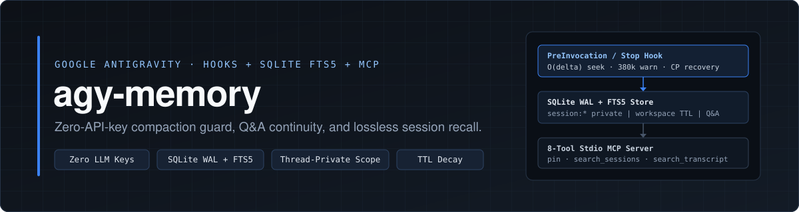
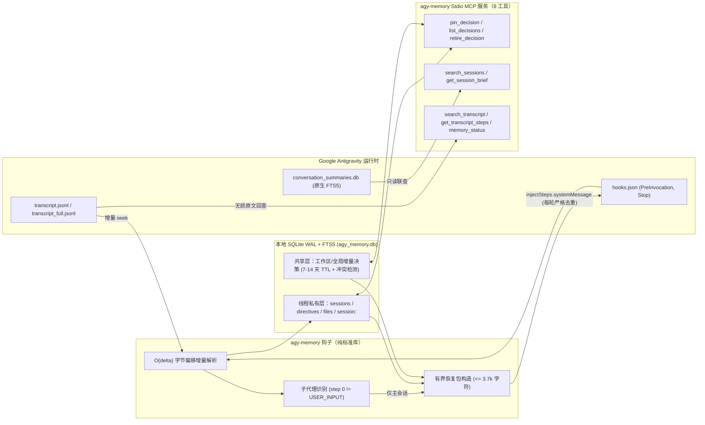

<p align="center">
  
</p>

<p align="center">
  <a href="README.md">English</a> &middot;
  <a href="#为什么需要-agy-memory">问题根因</a> &middot;
  <a href="#系统架构">系统架构</a> &middot;
  <a href="#可复现基准实测">基准实测</a> &middot;
  <a href="#快速上手">快速上手</a> &middot;
  <a href="#mcp-工具清单">MCP 工具</a> &middot;
  <a href="#边界与代价">边界与代价</a>
</p>

**`agy-memory`** 是面向 **Google Antigravity**（`Antigravity 2.0` / `agy` CLI）的轻量级本地压缩防失忆钩子与无损记忆检索层。

核心层**100% 纯 Python 标准库 + 本地 SQLite（WAL + FTS5）**（含内置零依赖 stdio JSON-RPC 2.0 MCP 服务）——**零第三方运行时依赖、零外部 LLM API Key、零云端账号、零后台常驻观察器进程**。

---

## 为什么需要 `agy-memory`？

对生产工作区中 **4 个长会话、共 19 次原生自动压缩**（13 次主会话 + 6 次子代理）的完整 `transcript_full.jsonl` 做逐条取证后，定位到 Antigravity 原生 `CHECKPOINT` 压缩的 5 个结构性短板：

| 实测问题（19 次原生自动压缩） | 基线实测数据 | 原生 `CHECKPOINT` 根因 | `agy-memory` 解法 |
| --- | --- | --- | --- |
| **1. 超过 10 轮的用户原话被硬截断** | >10 轮的主会话 **100%** 丢弃早期用户指令 | `# User Requests` 硬编码只保留最近 10 轮 | 按字节偏移增量写入 SQLite，压缩后优先恢复被挤出的早期陈述式约束 |
| **2. 10 轮内 Agent 刚发给用户的答案也会立即忘记** | 压缩前最近几轮纯问答回复要点留存率低至 **`0/6` / `0/5`** | 原生压缩清空 100% 历史 `PLANNER_RESPONSE`，摘要 80%+ 为代码施工进度，无「问答结论」栏 | 捕获发给用户的最终回复（`tool_calls == []`），确定性提炼结论/选项，压缩后还原最近 4 轮问答对照 + 原文 `step` 步号 |
| **3. 508k 才突然压缩且缺少 `PreCompact` 钩子** | 主会话压缩中位数 `508,690` tokens（`10/13` 缓存归零），手动 `/compact` 0 次 | 官方 `hooks.json` 未提供 `PreCompact` / `PostCompact` 事件 | 在 `PreInvocation` 追踪 token，到达 `380k`（可配）注入一次刷盘预警 |
| **4. 压缩后路径幻觉与重读风暴** | 压缩后 60 步内重读旧文件比例高达 **`12/12`（100%）**，第一步即猜错目录 | 摘要丢弃具体文件目录结构 | 按会话记录真实读写路径，压缩后注入紧凑路径锚点 |
| **5. 跨会话记忆空转** | 本机自带 `conversation_summaries.db`（FTS5）但未暴露给 Agent | 缺少检索历史会话与结构化决策的工具 | 提供 8 个 stdio MCP 工具，直连 `agy_memory.db` 与原生 `conversation_summaries.db` |

---

## 系统架构



### 防注意力稀释与防过时误导设计

1. **线程私有与跨线程严格隔离**：单线程临时规格走 `scope="session"`（强制校验 `conversation_id`，落库为 `session:<cid>`），只在当前线程压缩后恢复，**绝不串入同工作区其他并行线程**；跨线程长期拍板才走工作区 `scope`（不复写 `GEMINI.md` / `AGENTS.md` 已有规则）。
2. **子代理零污染**：通过 `transcript.jsonl` 第 0 步类型自动识别子代理；子代理启动返回 `{}`（`0` 字节注入），仅在子代理自己压缩时恢复它触达过的文件路径与自身私有置顶。
3. **自动过期（TTL）+ 年龄标签 + 冲突检测**：`veto`/`architecture`/`preference` 默认 14 天、`decision`/`lesson` 默认 7 天，到期自动停止注入前缀（仍可主动检索）；每条附 `[YYYY-MM-DD·N天前]` 并置顶「用户最新指令优先级最高」；`pin_decision` 写入时自动检测同作用域高相似旧条并返回 `potential_conflicts`。
4. **问句过滤 + 体积封顶**：自动剔除问句防止噪声入库；平时未压缩轮次严格返回 `{}`；压缩后恢复包去重后控制在 ~`3.2k–3.7k` 字符（用 1 行 `handoff.md` 时间戳指针替代 2KB 全文硬塞）。

---

## 可复现基准实测

仓库内置 100% 脱敏合成压测套件（625 步、24 轮用户对话冲至 508k tokens 并触发压缩，同时验证并行双线程与子代理），随时可一键复跑：

```bash
python benchmarks/run_benchmark.py
```

| 实测指标 | 实测结果 | 说明 |
| --- | ---: | --- |
| **常规轮次 `PreInvocation`（进程内）** | **1.67 ms** | 10 次中位数（增量 seek，返回 `{}`） |
| **常规轮次 `PreInvocation`（Windows Python 子进程）** | **107.68 ms** | 含 Python 解释器冷启动，返回 `{}` |
| **主会话首轮启动注入** | **537 字符**（`13.19 ms`） | 仅增量决策，零 `handoff.md` 重复 |
| **子代理首轮启动注入** | **0 字符**（`7.24 ms`） | 精准识别子代理，零注意力稀释 |
| **380k 压缩前预警** | **461 字符**（`21.07 ms`） | 每周期仅发 1 次；遇到 `CHECKPOINT` 自动重置 token 计数 |
| **压缩后防失忆恢复包** | **3,700 字符**（`37.82 ms`） | 硬预算封顶，每次 `CHECKPOINT` 仅发 1 次 |
| **压缩前最近问答回答召回** | **3 / 3（100%）** | 完整还原被原生压缩丢弃的选项与结论 |
| **10 轮前被挤出否决项召回** | **2 / 2（100%）** | 预算内优先保留含约束轮次 |
| **本线程私有置顶压缩后恢复** | **是（`true`）** | 线程 A `scope="session"` 正常还原 |
| **同工作区并行线程 B 串台泄露** | **0（`false`）** | 并行线程 B 启动与压缩均 0 泄露 |

---

## 快速上手

```bash
git clone https://github.com/JieX133/agy-memory.git
cd agy-memory
pip install -e .

# 自动备份并写入 ~/.gemini/config/hooks.json 与 MCP 配置（中文恢复包头部可加 --lang zh）
agy-memory install --lang zh

# 体检当前环境、SQLite FTS5、钩子接线与最近耗时
agy-memory doctor
```

卸载随时可逆：`agy-memory uninstall`（保留安装前自动生成的 `.bak-*` 备份）。

---

## MCP 工具清单

| 工具 | 作用 |
| --- | --- |
| `pin_decision` | 写入/更新线程私有（`scope="session"`）、工作区或全局决策，自带 TTL 与冲突提示 |
| `list_decisions` | 查看指定作用域活跃决策（工作区查询自动屏蔽其他线程 `session:*` 私有项） |
| `retire_decision` | 停用已过时或被推翻的决策 ID |
| `search_sessions` | 联查 Antigravity 原生 `conversation_summaries.db`（解码 `workspace_uris` 与 `title`）及 `agy_memory.db` |
| `get_session_brief` | 读取任意历史会话全量用户提问（突破 10 轮限制）、压缩步号、修改文件与末尾几轮 |
| `search_transcript` | 在单会话 `transcript_full.jsonl` 内做无损关键词检索 |
| `get_transcript_steps` | 按步号范围 `[start_step..end_step]` 展开压缩前任意对话原文 |
| `memory_status` | 查看库规模、过期条目数与最近 15 次钩子耗时日志 |

---

## 边界与代价

- **无法阻止原生 500k 压缩后的 Prompt Cache 清零**：缓存失效发生在 Antigravity 宿主内部；建议配合大输出沙箱 MCP（如 `context-mode`）一起使用，从源头延缓上下文膨胀。
- **Python 子进程启动开销**：Antigravity 的 `PreInvocation` 为同步钩子，本机实测逻辑本身仅 ~`1.7 ms`，但每次拉起 Python 解释器在 Windows 上约需 `90–110 ms`（相对模型每轮 3–15 秒推理耗时体感不明显）。
- **无 LLM 的确定性回答提炼**：超过 320 字的长回答只保留首句 + 标题 + 加粗/编号结论，长表格细节需按步号调用一次 `get_transcript_steps` 展开原文。
- **无法自动做语义级推翻判定**：若在 7–14 天有效期内口头推翻了某条已入库决策且当轮忘记调用 `retire_decision`，到期前该条仍会出现（靠年龄标签与最高优先级护栏降低误导）。

## 开源协议

[MIT](LICENSE)
